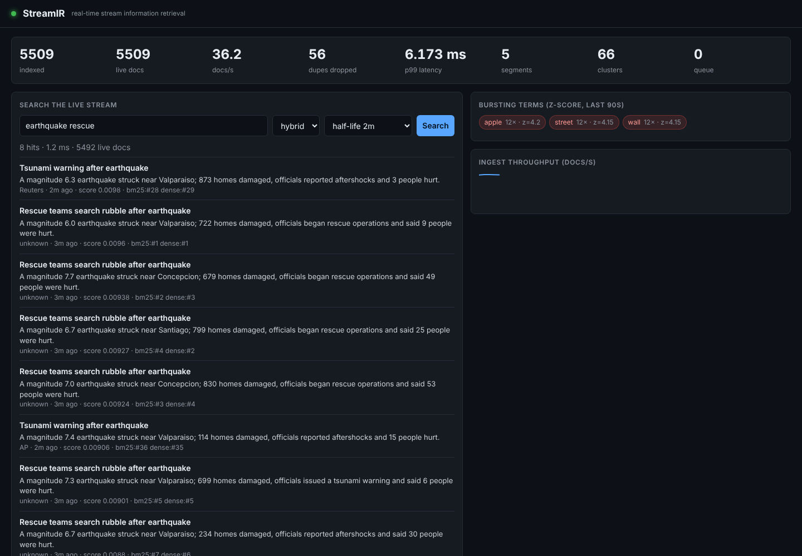

# StreamIR — Real-Time Stream-Based Information Retrieval

A from-scratch search engine for **data in motion**. Documents arrive continuously (news wire, RSS, API, log replay);
they become searchable *the instant they are ingested*, the system detects breaking topics, groups stories, drops
syndicated copies, and pushes alerts for **standing queries** — all in a single Python process with no external
database, no Elasticsearch/Kafka, and no pretrained model.



## Why this is different from a "search project"

Classic IR indexes a static corpus, then answers queries. Stream IR inverts three assumptions:

| Static IR | Stream IR (this project) |
|---|---|
| Index is built offline, then frozen | **Near-real-time index** — searchable at ingest, no refresh interval |
| Corpus only grows | **Sliding retention window** — old data expires by *event time* |
| Queries come to the data | **Data comes to the queries** — standing-query percolator |
| Relevance = text match | Relevance = text match **× recency decay**; plus burst/trend signals |
| Vocabulary is stable | **Streaming semantic vectors** that adapt as the stream drifts |

## Architecture

```
 sources ─► bounded queue ─► worker ───────────────────────────────────────────────┐
 (synthetic,   (back-pressure)  1 tokenise + stem                                  │
  JSONL, RSS,                   2 MinHash-LSH near-duplicate filter   ─► drop      │
  HTTP POST)                    3 NRT inverted index (memtable→segments, BM25)     │
                                4 Random-Indexing semantic vectors (learn+encode)  │
                                5 burst statistics (EWMA / Poisson z-score)        │
                                6 online story clustering (TF-IDF, single pass)    │
                                7 percolator: match doc against standing queries   │
                                8 write-ahead log (crash recovery)                 │
                                9 publish events ─► WebSocket / SSE / dashboard ◄──┘
 maintenance loop (1 Hz): expire window · merge segments · burst tick · WAL compaction

 query path:  BM25 ─┐
                    ├─► Reciprocal Rank Fusion ─► × exp(-ln2·age/half-life) ─► top-k + explain
        dense ──────┘
```

### Components (all in `streamir/`)

| Module | What it does | Key idea |
|---|---|---|
| `core/index.py` | NRT inverted index | LSM-style: mutable **memtable** → immutable **segments**, tiered merge, tombstones, O(1) whole-segment expiry; Okapi BM25 with global stats; `+must -not "phrase"` query syntax; time-decay |
| `core/dedup.py` | Near-duplicate filter | Word-shingle **MinHash** (64 perms) + **banded LSH** (16×4) for candidates, then *verified* by estimated Jaccard ≥ 0.8; bounded memory |
| `core/semantic.py` | Streaming semantic vectors | **Random Indexing**: sparse ternary index vectors + online context accumulation → learns "which words co-occur" in one pass, no training phase |
| `core/retriever.py` | BM25 / dense / **hybrid** | **Reciprocal Rank Fusion**, then recency decay |
| `core/burst.py` | Trend detection | Per-term EWMA mean/variance per time bucket; Poisson-aware z-score; idle-bucket decay; bounded vocabulary |
| `core/cluster.py` | Story clustering | Single-pass TDT-style leader clustering over sparse TF-IDF centroids, TTL eviction |
| `core/percolator.py` | Standing queries | Reverse index with **posting pruning**: each query is indexed under only its (n − need + 1) rarest terms — provably lossless (test compares against brute force) and ~20× faster at 10k queries |
| `pipeline.py` | Orchestration | asyncio, bounded queue back-pressure, drop-oldest pub/sub for slow consumers, WAL with torn-write tolerance |
| `api.py` + `static/` | Service | FastAPI REST, WebSocket, SSE, live dashboard |

## Quick start

```bash
pip install -r requirements.txt
python -m pytest -q                      # 30 tests
python -m streamir serve                 # http://localhost:8000  (synthetic live news stream)
python -m streamir bench --n 20000       # full evaluation, writes bench/RESULTS.md
python -m streamir generate --n 5000 --out data/sample.jsonl
python -m streamir serve --source jsonl:data/sample.jsonl     # replay a file in real time
python -m streamir serve --source "rss:https://feeds.bbci.co.uk/news/rss.xml"   # live RSS (needs internet)
```

### API

```bash
# search: modes bm25 | dense | hybrid; recency half-life in seconds; restrict to the last N seconds
curl "localhost:8000/search?q=earthquake+-aftershock&mode=hybrid&halflife=120&last=600&explain=true"

# push your own documents
curl -X POST localhost:8000/ingest -H 'content-type: application/json' \
     -d '[{"id":"1","title":"Chip launch","text":"Nvidia unveils a new AI chip"}]'

# standing query: get an alert whenever a matching doc arrives
curl -X POST localhost:8000/queries -H 'content-type: application/json' \
     -d '{"q":"nvidia chip +launch","min_match":0.6,"name":"Nvidia watch"}'
curl -N "localhost:8000/events?types=alert,burst"        # Server-Sent Events
# WebSocket /ws streams docs, alerts, bursts and stats (this is what the dashboard uses)

curl localhost:8000/trends ; curl localhost:8000/clusters ; curl localhost:8000/stats
curl "localhost:8000/similar?term=earthquake"            # nearest terms in the learned semantic space
```

Config via env vars (`STREAMIR_WINDOW`, `STREAMIR_RATE`, `STREAMIR_WAL`, …) — see `streamir/config.py`.

### Deploy on Render

1. Push this repository to GitHub.
2. In Render, choose **New → Web Service** and connect this repository.
3. Select **Docker** as the environment. Render will use the included `Dockerfile`.
4. Set the health check path to `/health`.
5. Add these environment variables:

   ```text
   STREAMIR_SOURCE=synthetic
   STREAMIR_RATE=40
   ```

6. Deploy and open the generated Render URL. The dashboard is at `/`, and the health check is at `/health`.

The container listens on Render's injected `PORT` value. For a service that accepts documents instead of generating
synthetic news, set `STREAMIR_SOURCE=none` and send documents to `POST /ingest`. This is a single-process service;
use one instance because the in-memory index is not shared between replicas.

## Evaluation

`python -m streamir bench` (full output in [`bench/RESULTS.md`](bench/RESULTS.md)). Single process, laptop-class CPU,
labelled synthetic news stream, 20,000 docs, 200 s retention window, virtual clock (deterministic):

| Metric | Result |
|---|---|
| End-to-end ingest (all 7 stages per doc) | **~650 docs/s**; per-doc latency p50 1.2 ms, p99 8.5 ms |
| Query latency (≈9.5k live docs) | BM25 p50 0.6 ms · dense 1.0 ms · hybrid 1.6 ms |
| Near-duplicate detection | precision 0.95 · recall 1.00 |
| Breaking-event detection | 7/8 events, median delay 0.8 s of event time; 12 false-alarm term bursts |
| Standing queries @ 10,000 registered | 0.37 ms/doc (≈2,700 docs/s) |
| Crash recovery | torn final WAL record tolerated; identical ranking after rebuild |
| Freshness | mean age of top-10: 103 s → 14 s with a 30 s half-life |

### Read these numbers critically (limitations)

* **The data is synthetic.** Ground truth comes from my generator, so every quality number is an *upper-bound-flavoured*
  sanity check, not a claim about real news. BM25 scores 1.000 on this benchmark because the queries are drawn from the
  generator's own vocabulary — **the benchmark is saturated for lexical retrieval and does not show hybrid beating BM25**
  (it doesn't: 0.968 vs 1.000). What it *does* show is that the dense component retrieves topically correct documents
  that share no word with the query (96% precision vs 12.5% chance), which BM25 cannot do at all.
  A defensible next step is evaluating on a real labelled stream (e.g. TREC Microblog/RTS or a news dataset).
* Random-Indexing vectors are weaker than transformer embeddings. They are chosen because they are *incremental, cheap and
  explainable*. Document vectors are frozen at ingest time, so they do not retroactively benefit from later learning.
* Clustering purity of 1.000 is a property of the easy synthetic topics, not a general result.
* Python's GIL caps throughput (~650 docs/s end-to-end). The architecture is partitionable by document id; this
  implementation is not distributed. There is no replication — the WAL gives single-node durability only.
* Stemming is a light rule-based stemmer (shown terms are stems), not Porter/Snowball.
* Document-frequency statistics include not-yet-merged deleted docs (as Lucene does), a small ranking approximation.

## Design decisions worth defending (viva / interview)

1. **Why LSM-style segments instead of one big dict?** Writes stay O(1) into the memtable; merges amortise cleanup; and
   expiry becomes dropping whole segments by `max_ts`, so retention costs almost nothing.
2. **Why event time, not arrival time?** Late/out-of-order data must still expire correctly; a min-heap keyed by event time handles it.
3. **Why verify LSH candidates?** My first version used SimHash+LSH alone and flagged ~1,400 false duplicates on template-heavy
   news; adding exact-ish Jaccard verification fixed precision (0.95) while LSH keeps candidate lookup constant-time.
   (Part of that was my synthetic data being too templated — I fixed both.)
4. **Why prune percolator postings?** Naïve term→query indexes get slower the more common the terms are. Indexing each query
   under only enough rare terms to make a match *possible* gives the same results with far fewer candidates (proved by the
   pigeonhole argument in the module docstring and checked against brute force in `tests/test_components.py`).
5. **Why drop-oldest pub/sub?** A slow dashboard must never stall ingestion; back-pressure applies to *sources* (bounded queue), not to *observers*.
6. **Why RRF?** BM25 scores and cosine similarities live on incomparable scales; rank fusion needs no calibration.

## Project layout

```
streamir/            core/ (index, dedup, semantic, retriever, burst, cluster, percolator), pipeline, sources, api, static/
tests/               30 tests: index semantics, expiry/merge, dedup, burst, clustering, percolator == brute force, WAL recovery, API/WebSocket
bench/benchmark.py   labelled evaluation; writes bench/RESULTS.md
docs/                dashboard screenshot, CV + report notes
```

## Extending it

Add a source: implement `async def stream(self) -> AsyncIterator[Document]` (see `sources.py`). Swap the semantic layer
for a sentence-transformer by implementing `encode/add/search` of `SemanticIndex`. Partition for scale-out by hashing `doc.id`
across N pipelines and merging top-k results (scatter-gather).
